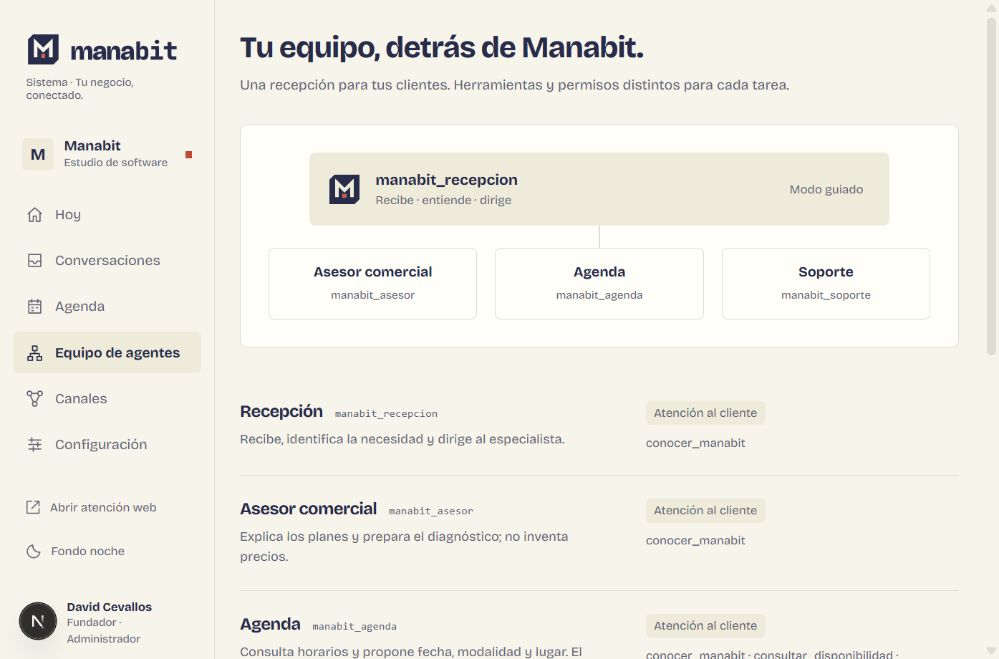
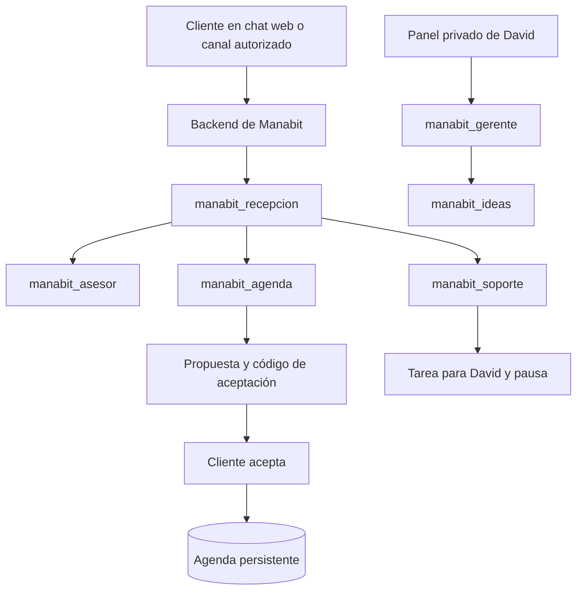

# Manabit Sistema

Recepción web, bandeja de conversaciones y agenda de diagnósticos de **Manabit, by David Cevallos**. Primer piloto: el propio estudio de Manabit. La landing pública conserva su proyecto independiente.



## Probar ahora

Requiere Node.js 24 o superior.

```powershell
npm ci
npm run dev
```

- Panel de David: http://127.0.0.1:3100
- Chat y reservas: http://127.0.0.1:3100/reservar

En desarrollo, el panel permite acceso desde localhost. En producción exige sesión de propietario, contraseña y secreto configurados. Los datos locales se guardan en `.data/manabit.sqlite`; no se suben a Git.

## Qué funciona

- Chat web con historial persistente, planes, preguntas sobre citas y derivación a David. Sin configuración de Google usa respuestas guiadas; no llama a Gemini ni se presenta como IA desplegada.
- Disponibilidad real de lunes a viernes, 09:00–17:00, Ecuador. Diagnóstico gratuito de 15 minutos, videollamada o visita al negocio del cliente. La duración puede ajustarse desde el panel.
- Reserva con aceptación, control de solapamientos e idempotencia. En presencial exige negocio y dirección; en videollamada indica que David compartirá el enlace hasta configurar uno.
- Panel con conversaciones, respuesta manual, pausa de automatización, tareas, agenda, cancelación y descarga `.ics`.
- Seis agentes ADK escritos en Python, agrupados en dos entradas separadas: atención pública y dirección interna. Las propuestas de cita requieren aceptación explícita del cliente antes de registrar una reserva.
- Adaptadores de texto para WhatsApp Cloud API, Instagram, Messenger y Telegram: firma de webhook, persistencia de eventos, deduplicación y estado de envío. Necesitan configurar y validar las cuentas reales.
- SQLite para desarrollo y adaptador PostgreSQL para despliegue. PostgreSQL incluye restricción de exclusión para evitar solapamientos entre instancias.

## Agentes y orquestación



Se despliegan **dos runtimes**, no seis aplicaciones sueltas. Los subagentes están definidos en código dentro de cada entrada. [Responsabilidades y permisos](docs/AGENTES.md).

## Próximo paso de David

Crea un proyecto de Google Cloud con nombre visible **Manabit Sistema** y un ID único. No necesitas crear los seis agentes manualmente. El paquete ya contiene sus nombres, herramientas e instrucciones.

[Guía de Google Cloud](docs/GOOGLE-CLOUD.md) · [Prueba paso a paso](docs/PRIMEROS-PASOS.md) · [Canales](docs/CANALES.md) · [Revisión de referencias de Platzi](docs/revision-repos-platzi.md).

No hay un proyecto de Google configurado ni recursos cloud desplegados en esta entrega. El script `agents/deploy.py` valida localmente por defecto; solo crea recursos al añadir `--execute`.

## Configuración y despliegue

```powershell
node scripts/setup-local.mjs
```

Genera `.env.local` con secretos distintos sin imprimirlos. La configuración de Google y las redes permanece vacía y los envíos sociales están pausados. Para Google local usa ADC; no incluyas claves de cuentas de servicio en el navegador.

La imagen `Dockerfile` ejecuta Next.js en Cloud Run con Node 24. Allí es obligatorio `DATABASE_URL` de PostgreSQL, además de las credenciales del propietario y `APP_URL` de producción. [Arquitectura y límites](docs/arquitectura.md).

## Verificación

```powershell
npm test
npm run typecheck
npm run build
npm run verify:production
# Desde agents, después de instalar requirements.txt en su entorno virtual:
.venv/Scripts/python.exe -m unittest discover -s tests -v
```

**21 pruebas Node y 5 pruebas Python correctas**, más una prueba HTTP del build en producción (login, panel privado, origen, permisos y chat). Las pruebas cubren horarios, aceptación, reintentos, concurrencia local, persistencia SQLite, firmas, permisos de herramientas y separación de los dos grafos ADK. No se han ejecutado llamadas a Gemini, pruebas contra cuentas sociales, despliegues cloud ni pruebas contra PostgreSQL real. La compilación y el recorrido web se verifican localmente.

## Límites del piloto

Una cuenta de negocio, Manabit, y un propietario. El núcleo admite configuraciones de otros sectores, pero todavía no hay registro de empresas, roles de empleados ni aislamiento SaaS verificado. No sincroniza Google Calendar, crea enlaces de Meet, publica contenido, envía recordatorios programados ni entiende audio o imágenes. La descarga `.ics` es manual. No bloquea tiempos de desplazamiento entre negocios; David debe ajustar esos horarios antes de atender visitas consecutivas.

Los eventos sociales se guardan antes de devolver el webhook y se procesan tras la respuesta. Para recuperar trabajo interrumpido en Cloud Run hay un endpoint de worker autenticado; debe programarse según la guía antes de activar redes. Un envío con timeout puede haber llegado al proveedor: revisa ese caso antes de reintentar.

## Estructura

```text
src/app/             Next.js: panel, recepción, login y API
src/components/      Interfaz y loader original de Manabit
src/server/          Datos, sesiones, agentes, reservas y canales
src/core/            Motor configurable de reservas
agents/              Grafos Google ADK, herramientas, despliegue y pruebas
public/brand/        Activos propios del kit Manabit
scripts/             Configuración local
tests/              Pruebas de dominio e integración local
docs/               Arquitectura y operación
```

Diseñado y desarrollado by David Cevallos · Manabit.
