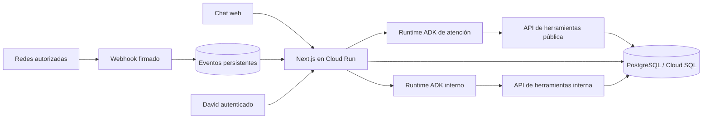

# Arquitectura implementada y evolución

## Piloto actual

Next.js 16 sirve el panel y el chat público, con API Node.js y cookies firmadas. SQLite local conserva conversaciones, tareas, propuestas, consentimientos, eventos, entregas y citas. PostgreSQL es el adaptador de producción. El núcleo TypeScript valida reglas sin depender del modelo.

El backend se conecta mediante ADC a dos runtimes ADK: atención pública y dirección interna. Python llama herramientas HTTP limitadas a la audiencia. La información del negocio y la disponibilidad siempre se leen del servidor.

## Escrituras críticas

La reserva tiene clave de idempotencia y huella de sus datos. SQLite usa inserción atómica condicionada. PostgreSQL añade exclusión GiST de rangos por negocio y profesional. La cancelación libera el intervalo y conserva el registro. Se guardan horas UTC y se presentan en America/Guayaquil.

Los mensajes y la intervención manual comparten exclusión por conversación. Los workers reclaman cada evento mediante un lease de base de datos; tras un fallo de proceso la reclamación vence en dos minutos. Un turno reentregado conserva el evento, no duplica la respuesta si ya terminó. No se garantiza exactamente una ejecución remota si el proceso muere durante una llamada a Gemini.

Los webhooks se validan y persisten antes de responder. `after()` inicia el procesamiento, pero no constituye una cola durable por sí solo. `POST /api/worker/jobs`, autenticado con un secreto distinto, recupera pendientes; requiere un programador externo en producción. Los eventos fallidos se revisan desde el panel y se reintentan expresamente.

## Fronteras actuales

Una sola cuenta, `manabit`, y David como propietario. El esquema lleva tenant, pero las rutas usan la cuenta fija: no hay onboarding multiempresa ni se acepta un tenant arbitrario desde el navegador. Antes de ofrecerlo como SaaS habrá que añadir identidad de negocio autenticada, membresías, permisos y pruebas de aislamiento entre todas las rutas.

Producción usa contraseña larga, cookie HttpOnly/Secure/SameSite, firma HMAC y rechazo de POST de otro origen. Rate limits persistentes limitan login y chat; no reemplazan controles de abuso/costes del proveedor. No hay MFA, reset de clave por email ni SSO en este MVP.

No hay sincronización con Google Calendar: una cita externa en tu calendario no bloquea automáticamente disponibilidad en Manabit. Tampoco hay tiempos de traslado configurados. Antes de usar agenda pública en operación real hay que ajustar esas políticas.

## Próximas etapas

1. Desplegar web, PostgreSQL y runtime público; probar contratos REST y herramientas con la cuenta real.
2. Conectar una red y verificar mensajes, ventana de respuesta, fallos y recuperación del worker.
3. Integrar Google Calendar, recordatorios y políticas de desplazamiento.
4. Automatizar migraciones, respaldos, retención/exportación/eliminación de datos, alertas y evaluaciones del agente.
5. Para mayor volumen: Cloud Tasks/Pub/Sub y workers dedicados; no están integrados en el código actual.
6. Separar configuración y permisos por empresa para el piloto del consultorio.
